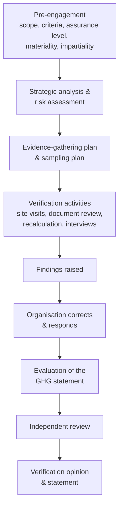

# Verification process

*ISO 14064-3:2019; ISO 14064-1:2018, clause 10*

## Stages

## What we agree with the verifier up front

| Item | Our position |
|---|---|
| Subject | GHG statement for FY____ covering Categories __ |
| Criteria | ISO 14064-1:2018 and this repository's documented methods |
| Level of assurance | Reasonable / Limited |
| Materiality | Quantitative threshold _5_% of total (verifier's call, agreed in advance), plus qualitative factors |
| Intended users | |
| Verification body accreditation | ISO 14065 by _[UKAS / other]_ |

**Reasonable or limited assurance?**

- **Reasonable assurance** needs more evidence. It is usually expected for
  Categories 1 and 2, and for regulatory or financing uses.
- **Limited assurance** is common for Categories 3–6.

## What we provide

Hand the verifier this checklist: the
[verification readiness checklist](verification-readiness-checklist.md).

## Handling findings

- Log each finding as a GitHub issue using the *Verification finding*
  template, and in `inventory/<year>/findings-log.csv`.
- Classify each one:
    - **Non-conformity.** The requirements are not met.
    - **Misstatement.** The numbers are wrong.
    - **Observation.** An improvement opportunity.
- Fix each by PR, link the PR to the issue, and get the verifier to agree
  it is closed.
- Uncorrected misstatements are added together and compared with the
  materiality threshold.

## Facts discovered after verification

If an error is found after the opinion has been issued, tell the verifier.
Then assess it against the base-year recalculation threshold.
