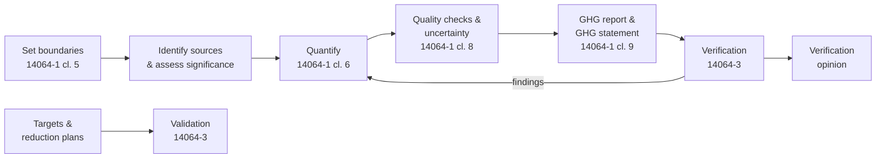

# Corporate GHG Accounting under ISO 14064

This site documents how **[Organisation]** prepares, controls, reports and
assures its organisation-level greenhouse gas inventory.

## The process at a glance

## Where to start

1. Read the [principles](00-overview/principles.md) and the
   [ISO 14064 family overview](00-overview/iso-14064-family.md).
2. Agree the [organisational boundary](01-inventory-design/organisational-boundary.md)
   and [reporting boundary](01-inventory-design/reporting-boundary.md).
3. Follow the [inventory management plan](03-data-management/inventory-management-plan.md)
   for the annual cycle.
4. Prepare for [verification](05-verification/verification-process.md).

## Roles

| Role | Name | Responsibility |
|---|---|---|
| Inventory owner | _TBC_ | Accountable for the GHG statement |
| Inventory manager | _TBC_ | Runs the annual cycle, maintains this repository |
| Data owners | _TBC_ | Supply and sign off activity data per source |
| Internal reviewer | _TBC_ | Independent check before verification |
| Verification body | _TBC_ | Accredited to ISO 14065 |
